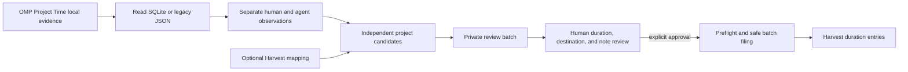

# Architecture

## Current Data Flow

JavaScript owns evidence loading, source-separated local-day reports, within-project interval union, and review-marked same-session response gaps. Different projects remain independently countable; no global wall-clock cap is imposed. The existing compact timesheet remains a human-active-only preview. The advisory generated summary never changes evidence or approves a factual note.

Private review batches persist candidate and reviewer-adjusted durations outside Git. The Ruby adapter owns account/user-scoped preflight, assignment resolution, stopped-duration creates, stable external references, and private submission receipts. One explicit approval authorizes a snapshot; there is no unattended scheduler or automatic modification/deletion of existing provider entries.

## Components and Ownership

| Component | Responsibility | Detail authority |
| --- | --- | --- |
| `project-time.js` | Evidence loading, filtering, grouping, mapping projection, drafts, and timesheet formatting | Source comments and `test/project-time.test.js` |
| `index.js` | OMP command, completion, tool registration, interactive summary lifecycle, and CLI invocation | Source comments and `test/omp-plugin.test.js` |
| `project-time-report.js` | Source-separated daily analytics, same-session gap inference, independent project candidates, and review-batch records | `test/project-time-report.test.js` |
| `worklog-workflow.js` | Private batch preparation, OMP review/approval orchestration, and structured CLI submission | `test/worklog-workflow.test.js` |
| `lib/omp_worklog.rb` and `lib/omp_worklog/work_entry_cli.rb` | Harvest CLI validation and writes | Source comments and `test_omp_worklog.rb` |
| `lib/omp_worklog/batch_cli.rb` | Reviewed-batch validation, provider preflight/filing, and recovery receipts | `test_batch_cli.rb` |
| `package.json` and gemspec | Published package metadata and included artifacts | Manifest files |

## Design Constraint

Local analytics and review preparation remain useful without Harvest credentials, assignments, or network access. Source observations, policy candidates, approved work-log records, and destination receipts are distinct boundaries. The provider consumes a reviewed record; it must not become the source of the original evidence.

## Runtime and Language Boundaries

JavaScript runs inside OMP and owns local SQLite/JSON evidence, completion, deterministic transforms, and advisory summaries. Ruby owns the standalone Harvest CLI and uses `marlens-harvest-api-v2`, `business_time`, and `holidays` for destination access and business-day rules. The OMP write tool invokes the executable with argument arrays rather than shell interpolation.

Keep these boundaries rather than translating the project solely to use one language. A rewrite would replace working Harvest and holiday dependencies while still requiring a JavaScript OMP entry point. Reconsider consolidation only with a concrete deployment, dependency, or correctness problem and equivalent no-write/write-boundary QA.

## Precision and Live Evidence

Raw milliseconds determine whether a draft exists and how long it lasts. Decimal `hours` are a rounded projection, not a filter or a billing rule: a positive interval can legitimately display `hours: 0`. Date ranges are inclusive local calendar days; invalid calendar dates are errors, not empty evidence.

SQLite may commit changes to its write-ahead log before changing the main database file. Project-name completion therefore invalidates its cache on both database and WAL metadata. Opening the reader remains read-only; completion must not checkpoint or alter upstream evidence.

## Plugin Configuration Authority

The host owns persisted user plugin settings and project overrides. The asynchronous factory calls the supported `omp plugin config list omp-worklog --json` CLI once, using `pi.cwd`, before registering commands and tools. The CLI resolves user settings plus project overrides; explicit factory options then override that result. Completion, commands, and tools capture the same effective configuration. Programmatic callers must await initialization; focused tests can inject the settings loader.

This adds one asynchronous subprocess at startup, using the existing subprocess adapter rather than a separate settings-file parser. It preserves host scope resolution without depending on private imports. Resolution errors fail initialization with a diagnostic rather than silently registering incorrect destinations. Configuration changes take effect on extension reload or a new OMP process.

An in-process host API could remove the subprocess later, but is not required for correct scope resolution. [OMP Worklog #134](https://github.com/klondikemarlen/omp-worklog/issues/134) records the activation contract; [upstream OMP #12043](https://github.com/can1357/oh-my-pi/issues/12043) remains the separate extension-API request. Do not duplicate the host's lock-file parser or bypass project precedence.
