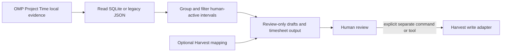

# Architecture

## Current Data Flow

The JavaScript integration owns the read-only path: it reads the Project Time log, groups intervals by local date and activity, and emits deterministic drafts or compact interactive totals. The interactive summary is advisory and review-marked. It does not change source evidence or create a destination entry.

The Ruby CLI owns the current Harvest write adapters. `time-off` and `work-entry` validate their inputs before calling Harvest. The approved OMP time-off tool invokes that CLI path. These explicit write surfaces are intentionally separate from the evidence transform.

## Components and Ownership

| Component | Responsibility | Detail authority |
| --- | --- | --- |
| `project-time.js` | Evidence loading, filtering, grouping, mapping projection, drafts, and timesheet formatting | Source comments and `test/project-time.test.js` |
| `index.js` | OMP command, completion, tool registration, interactive summary lifecycle, and CLI invocation | Source comments and `test/omp-plugin.test.js` |
| `lib/omp_worklog.rb` and `lib/omp_worklog/work_entry_cli.rb` | Harvest CLI validation and writes | Source comments and `test_omp_worklog.rb` |
| `package.json` and gemspec | Published package metadata and included artifacts | Manifest files |

## Design Constraint

The local evidence transform is useful without Harvest credentials, assignments, or network access. Keep this read-only analytical path independent from any destination adapter. A future provider-neutral time-log record belongs between `Transform` and `Review`; an integration may consume a reviewed record, but must not become its source of truth.

## Runtime and Language Boundaries

JavaScript runs inside OMP and owns local SQLite/JSON evidence, completion, deterministic transforms, and advisory summaries. Ruby owns the standalone Harvest CLI and uses `marlens-harvest-api-v2`, `business_time`, and `holidays` for destination access and business-day rules. The OMP write tool invokes the executable with argument arrays rather than shell interpolation.

Keep these boundaries rather than translating the project solely to use one language. A rewrite would replace working Harvest and holiday dependencies while still requiring a JavaScript OMP entry point. Reconsider consolidation only with a concrete deployment, dependency, or correctness problem and equivalent no-write/write-boundary QA.

## Precision and Live Evidence

Raw milliseconds determine whether a draft exists and how long it lasts. Decimal `hours` are a rounded projection, not a filter or a billing rule: a positive interval can legitimately display `hours: 0`. Date ranges are inclusive local calendar days; invalid calendar dates are errors, not empty evidence.

SQLite may commit changes to its write-ahead log before changing the main database file. Project-name completion therefore invalidates its cache on both database and WAL metadata. Opening the reader remains read-only; completion must not checkpoint or alter upstream evidence.

## Plugin Configuration Authority

The host owns persisted user plugin settings and project overrides. Manifest declarations describe available settings; they do not prove that the host passes effective values to the extension. The factory currently consumes explicit options, but the supported host API does not supply resolved plugin settings. See [OMP Worklog #134](https://github.com/klondikemarlen/omp-worklog/issues/134) and [upstream OMP #12043](https://github.com/can1357/oh-my-pi/issues/12043).

Do not duplicate the host's lock-file parser, import unsupported host internals, or ignore project precedence to work around that missing capability. Once a supported resolver exists, resolve settings for the factory cwd before registration, then apply explicit factory options as overrides. Commands, tools, and completion must share the same effective configuration.
